<a href="https://tristangautama.xyz">PORTFOLIO</a> &nbsp;·&nbsp; <a href="https://www.linkedin.com/in/tristangautama">LINKEDIN</a> &nbsp;·&nbsp; <a href="https://github.com/tristangautamaa?tab=repositories">REPOSITORIES</a>

 

**LIVE ▸** [energy-dss](https://tristangautamaa.github.io/energy-dss/) · [migravia.id](https://migravia.id) · [sensify.id](https://sensify.id) · [griyaplast.shop](https://griyaplast.shop) · [pph-project](https://pph-project.vercel.app)

**SOURCE ▸** [energy-dss](https://github.com/tristangautamaa/energy-dss) · [Speak-AI](https://github.com/tristangautamaa/Speak-AI) · [stock-ai-whatsapp-alert](https://github.com/tristangautamaa/stock-ai-whatsapp-alert) · [sensify-website](https://github.com/tristangautamaa/sensify-website) · [pph-website](https://github.com/tristangautamaa/pph-website) · [zeat-app](https://github.com/tristangautamaa/zeat-app) · [diabetes-prediction](https://github.com/tristangautamaa/Machine-Learning-Algorithms-for-Diabetes-Prediction) · [Zero-EAT](https://github.com/tristangautamaa/Zero-EAT)

 

<!-- one responsive SVG per section; colors follow the viewer's light/dark preference.
     SVGs are generated by scripts/gen.py from assets/data.json, which a weekly GitHub Action
     (.github/workflows/telemetry.yml) refreshes via scripts/fetch_data.py -->
