 

 

 

 

 

 

 

**LIVE ▸** [migravia.id](https://migravia.id) · [sensify.id](https://sensify.id) · [griyaplast.shop](https://griyaplast.shop)

**SOURCE ▸** [sensify-website](https://github.com/tristangautamaa/sensify-website) · [zeat-app](https://github.com/tristangautamaa/zeat-app) · [Zero-EAT](https://github.com/tristangautamaa/Zero-EAT)

 

<!-- SVGs are generated by scripts/gen.py from assets/data.json, which a weekly GitHub Action
     (.github/workflows/telemetry.yml) refreshes via scripts/fetch_data.py. Fonts are embedded per SVG. -->
